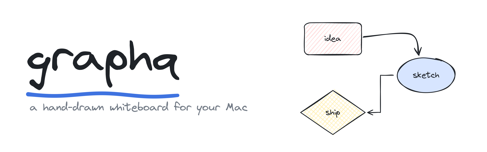
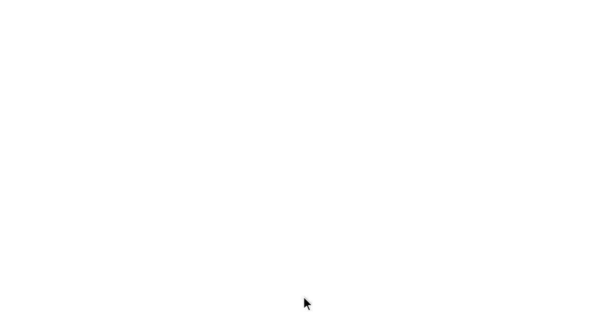
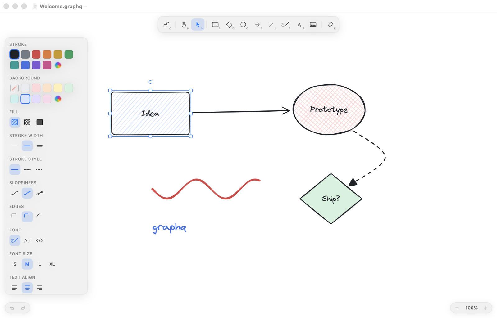

<p align="center">
  <picture>
    <source media="(prefers-color-scheme: dark)" srcset="docs/banner-dark.png">
    
  </picture>
</p>

<p align="center">
  Diagrams, charts and sketches with a hand-drawn feel.<br>
  A native macOS app: no browser, no accounts, no cloud.
</p>

<p align="center">
  <a href="https://github.com/fnkxyw/graphq/releases/latest"><b>Download for macOS</b></a>
  &nbsp;·&nbsp;
  <a href="#features">Features</a>
  &nbsp;·&nbsp;
  <a href="#keyboard-shortcuts">Keyboard shortcuts</a>
</p>

<p align="center">
  <picture>
    <source media="(prefers-color-scheme: dark)" srcset="docs/demo-dark.gif">
    
  </picture>
</p>

## Installation

1. Download `graphq.dmg` from the [Releases](https://github.com/fnkxyw/graphq/releases/latest) page.
2. Drag **graphq** into **Applications**.
3. Launch it from Launchpad or Spotlight.

Requires macOS 14 Sonoma or later.

> [!NOTE]
> graphq isn't notarized by Apple yet, so macOS will block it on first launch.
> Open **System Settings → Privacy & Security** and click **Open Anyway**,
> or run this in Terminal:
> ```sh
> xattr -dr com.apple.quarantine /Applications/graphq.app
> ```

<details>
<summary>Build from source</summary>

<br>

Requires Xcode 16 or the Command Line Tools.

```sh
git clone https://github.com/fnkxyw/graphq.git && cd graphq
make install
```

</details>

## Features

<table>
<tr>
<td width="50%" valign="top">

**Like pen on paper**<br>
Wobbly lines, hatch fills and a handwritten font. Three levels of sloppiness, from a neat blueprint to a cartoonish doodle.

</td>
<td width="50%" valign="top">

**Arrows that stay attached**<br>
Arrows snap to shapes and follow them around. Straight, curved or elbow, with labels right on the line.

</td>
</tr>
<tr>
<td valign="top">

**Pressure-sensitive pencil**<br>
Smooth strokes of varying width. On a graphics tablet, pen pressure is taken into account.

</td>
<td valign="top">

**Export anywhere**<br>
PNG, SVG and PDF, light or dark, with or without a background. `⇧⌥⌘C` copies the selection as an image.

</td>
</tr>
<tr>
<td valign="top">

**Plays nice with Excalidraw**<br>
Opens `.excalidraw` files as-is and uses the same keyboard shortcuts.

</td>
<td valign="top">

**A real Mac app**<br>
Tabs, autosave, version history, dark mode. Thousands of shapes without lag.

</td>
</tr>
</table>

<p align="center">
  <picture>
    <source media="(prefers-color-scheme: dark)" srcset="docs/screenshot-dark.png">
    
  </picture>
</p>

## Keyboard shortcuts

| | | | |
|:--|:--|:--|:--|
| `V` select | `R` rectangle | `O` ellipse | `D` diamond |
| `A` arrow | `L` line | `P` pencil | `T` text |
| `E` eraser | `H` hand | `Q` lock tool | `?` all shortcuts |

Double-click on empty canvas to add text, or on a shape or arrow to add a label. Hold `Space` and drag to pan the canvas; `⇧1` zooms to fit everything.

---

<p align="center">
  <sub><a href="LICENSE">MIT</a> · Virgil font under <a href="Sources/SketchRender/Resources/Fonts/OFL-Virgil.md">SIL OFL 1.1</a> · inspired by <a href="https://excalidraw.com">Excalidraw</a></sub>
</p>
