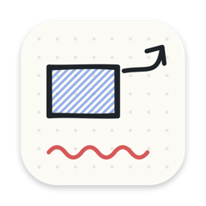
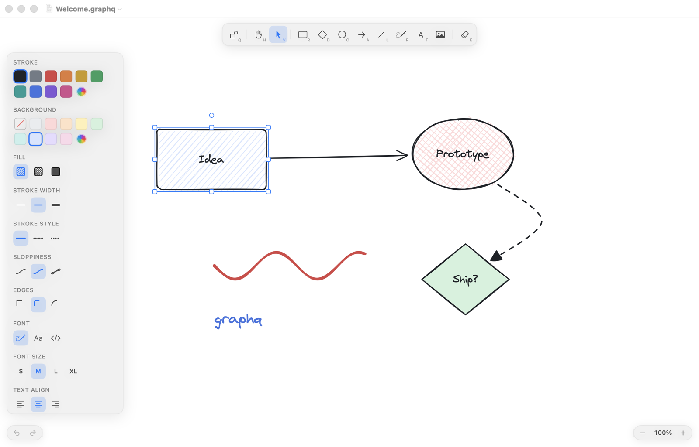
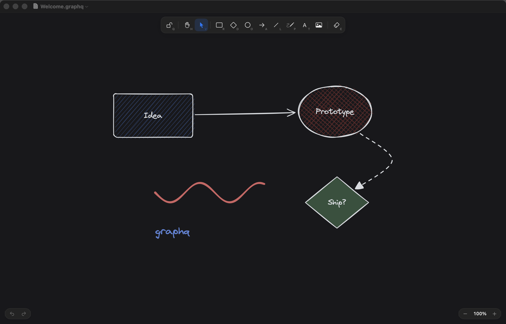

<p align="center">
  
</p>

<h1 align="center">graphq</h1>

<p align="center">
  Нативная macOS-доска для схем, диаграмм и набросков в стиле «от руки».<br>
  Вдохновлено <a href="https://excalidraw.com">Excalidraw</a>, написано на Swift: без Electron и веб-вью.
</p>

<p align="center">
  
  
  
  <a href="LICENSE"></a>
  <a href="https://github.com/fnkxyw/graphq/actions/workflows/ci.yml"></a>
</p>

<p align="center">
  
  
</p>

---

## Установка

### Вариант 1: готовое приложение

1. Скачайте `graphq.dmg` со страницы [**Releases**](https://github.com/fnkxyw/graphq/releases/latest).
2. Откройте DMG и перетащите **graphq** в папку **Applications**.
3. Запускайте из Launchpad или Spotlight (`⌘ Space` → «graphq»).

> [!NOTE]
> Приложение подписано ad-hoc, но не нотаризовано Apple, поэтому при первом запуске macOS его заблокирует.
> Откройте **Системные настройки → Конфиденциальность и безопасность** и нажмите **«Всё равно открыть»** рядом с сообщением о graphq.
> Другой способ — одна команда в Терминале:
> ```sh
> xattr -dr com.apple.quarantine /Applications/graphq.app
> ```

### Вариант 2: собрать из исходников

Нужны macOS 14 Sonoma или новее и Swift 6: Xcode 16+ или только Command Line Tools (`xcode-select --install`).

```sh
git clone https://github.com/fnkxyw/graphq.git
cd graphq
make install
```

`make install` соберёт `graphq.app` и положит его в `/Applications`. Дальше graphq открывается как обычное приложение, а файлы `.graphq` — двойным кликом в Finder.

| Команда | Что делает |
|---|---|
| `make install` | Собрать и установить в `/Applications` |
| `make run` | Собрать `build/graphq.app` и сразу запустить |
| `make dmg` | Собрать установщик `build/graphq.dmg` |
| `make test` | Unit-тесты (swift-testing) |
| `make clean` | Удалить артефакты сборки |
| `swift run graphq` | Быстрый запуск без бандла для разработки. Сохранение файлов надёжно работает только из `.app` |

Для примера откройте [`Examples/Welcome.graphq`](Examples/Welcome.graphq).

---

## Возможности

**Холст**
- Бесконечный холст. Панорамирование: два пальца на трекпаде, `Space` + drag, средняя кнопка мыши или инструмент «Рука».
- Зум: pinch, `⌘` + колесо, `⌘+` / `⌘−`, `⌘0` — 100%, `⇧1` — вписать всё, `⇧2` — вписать выделение.
- Точечная сетка с привязкой (`⌘'`).
- Привязка к краям и центрам других объектов с розовыми направляющими (`⌥S`; удерживайте `⌘`, чтобы отключить на время).

**Инструменты** (клавиши как в Excalidraw)

| | | | |
|---|---|---|---|
| `V` выделение | `R` прямоугольник | `O` эллипс | `D` ромб |
| `A` стрелка | `L` линия | `P` карандаш | `T` текст |
| `E` ластик | `H` рука | `⇧⌘K` картинка | `Q` не сбрасывать инструмент |

- **Стрелки цепляются к фигурам** и следуют за ними при перемещении и ресайзе.
- Изгиб стрелки за среднюю ручку или режим *Curved*. Наконечники: стрелка, треугольник, точка, черта, ромб.
- Ломаные по кликам: `↵` или `Esc` завершают; клик по первой точке замыкает линию.
- Текст: двойной клик по пустому месту. Подпись фигуры: двойной клик по фигуре или `↵`.
- Картинки: drag & drop, `⌘V` или меню. Перетащенные файлы `.graphq` и `.excalidraw` вливаются в текущий рисунок.

**Стиль «от руки»**
- Собственный порт rough.js: дрожащие линии, двойной штрих, заливки hachure, cross-hatch и solid. Seed хранится в элементе, поэтому фигуры не «прыгают».
- Sloppiness: Architect, Artist, Cartoonist.
- Карандаш с переменной толщиной (порт perfect-freehand). Поддерживает давление пера на графическом планшете.
- Шрифты: рукописный Virgil, SF Pro, SF Mono.

**Редактирование**
- Выделение рамкой и `⇧`-кликом.
- Ресайз за 8 ручек: `⇧` сохраняет пропорции, `⌥` тянет от центра. Работает и для повёрнутых фигур.
- Поворот с шагом 15° при зажатом `⇧`.
- Группы (`⌘G` / `⇧⌘G`), слои (`⌘[` `⌘]` `⌥⌘[` `⌥⌘]`), дублирование (`⌘D`, `⌥` + drag), выравнивание и распределение, блокировка (`⇧⌘L`).
- Полноценный Undo/Redo, включая изменения стиля.
- Буфер обмена между документами. `⇧⌥⌘C` копирует выделение как PNG.

**Панель свойств.** Появляется при выделении:
- цвет обводки и фона: палитра из 10 приглушённых цветов плюс системная палитра;
- тип заливки, толщина и стиль линии, sloppiness, скругление углов;
- наконечники стрелок, шрифт, размер и выравнивание текста;
- прозрачность, слои, действия.

**Документы**
- Несколько окон и вкладки, автосохранение, Versions (Файл → Вернуть к…), недавние файлы.
- Формат `.graphq`: JSON с версией схемы и встроенными картинками.
- Импорт `.excalidraw`: открыть файл напрямую или Файл → Import Excalidraw… (`⇧⌘I`).
- Экспорт (`⇧⌘E`):
  - PNG в масштабе 1× / 2× / 3×, SVG со встроенным шрифтом, PDF;
  - с фоном или без, светлый или тёмный вариант, всё или только выделенное.

**Интерфейс**
- Холст на всё окно, плавающий тулбар, индикатор зума.
- Светлая и тёмная темы. В тёмной теме цвета инвертируются по светлоте с сохранением оттенка.
- Шпаргалка по `?`, настройки по `⌘,`.

---

## Архитектура

```
Sources/
├── SketchCore/      Модель и геометрия без UI: элементы (value-типы, Codable), hit-test,
│                    пересечения, binding стрелок, snap, выравнивание, пространственный индекс,
│                    rough.js и perfect-freehand порты, формат файла, импорт Excalidraw
├── SketchRender/    Core Graphics / Core Text: отрисовка с кэшем путей, текст, экспорт PNG/PDF/SVG
└── graphq/          Приложение
    ├── App/         DocumentGroup, документ, меню, настройки
    ├── Store/       SceneStore: элементы, выделение, история (undo)
    ├── Canvas/      CanvasView (AppKit): ввод, отрисовка, dirty rects, редактор текста
    ├── Tools/       State machine для каждого инструмента
    └── UI/          SwiftUI: тулбар, панель свойств, экспорт, настройки
Tests/               Unit-тесты ядра и рендера
```

- **Undo через снапшоты.** Элементы — структуры, массив копируется по COW. Одно перетаскивание даёт ровно одну запись истории.
- **Кэш rough-путей.** Ключ кэша меняется только при изменении формы, поэтому перемещение тысячи фигур не пересчитывает геометрию.
- **Перерисовка.** Перерисовываются только изменившиеся области. Видимые элементы выбираются через пространственный индекс.
- **Производительность.** 2000 элементов рисуются примерно за 13 мс при бюджете кадра 60 fps 16,7 мс. Замер есть среди тестов.

Сторонних зависимостей нет.

## Выпуск новой версии

```sh
git tag v1.0.0
git push origin v1.0.0
```

GitHub Actions прогонит тесты, соберёт `graphq.dmg` и опубликует его в Releases.

## Roadmap

- Ортогональные (elbow) стрелки и подписи на стрелках.
- Фреймы, библиотеки фигур, экспорт в `.excalidraw`.
- Rich text, обрезка картинок.
- Совместное редактирование.
- Metal-рендерер для 50k+ элементов.
- Локализация интерфейса (сейчас только английский).
- Нотаризация Apple.

## Лицензия

[MIT](LICENSE). Шрифт Virgil распространяется по [SIL Open Font License 1.1](Sources/SketchRender/Resources/Fonts/OFL-Virgil.md).
